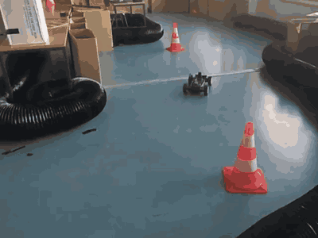

# F1TenthRL

Reinforcement learning for [F1TENTH](https://f1tenth.org) autonomous racing: a PPO policy that learns to drive laps from LiDAR scans and its own speed, trained in simulation and **deployed on a real 1/10-scale car**.



<sub>The real car on an indoor track marked with cones and ducting. [Full video (mp4)](media/demo.mp4).</sub>

## How it works

- **Observation:** the 1081-beam LiDAR scan plus forward speed. **Action:** steering and speed.
- **Policy:** PPO ([Stable-Baselines3](https://github.com/DLR-RM/stable-baselines3)) with a custom feature extractor: an MLP for the scan, a small encoder for the speed, merged into one feature vector (`src/feature_extractor.py`).
- **Reward:** sparse. +100 for finishing the lap, -100 for a collision, -50 for stalling or timing out, and +0.1 per step otherwise (`_shape_reward` in `src/f110_sb_env.py`).
- **Action repeat:** each action is held for 0.1 s of simulation, i.e. 10 Hz control (`StickyActionWrapper`).
- **Hyperparameters** come from an Optuna study of 50 trials (`optuna_studies/`).
- **Multiple tracks:** an optional `MultiMapWrapper` swaps the map on every reset, so the policy does not overfit one track.
- **Neuroevolution (branch `ga`):** refines a trained policy for lap time. Each generation mutates the output layer of 20 copies with Gaussian noise and keeps the 5 fastest.

## Tooling

- Action recording and a playback agent to replay and debug runs, live LiDAR rendering, TensorBoard logs.
- A raceline-following baseline agent (work in progress).
- `src/test_comms.py`: a small client for the socket interface that exchanges LiDAR scans and speed/steering commands.

## Run it

Setup follows [`notes/SETUP.md`](notes/SETUP.md) (it needs [this `f1tenth_gym` fork](https://github.com/usiddiquie/f1tenth_gym), which exposes the LiDAR parameters and works with SB3).

```bash
python main.py   # trains when train = 1 in main(); set it to 0 to replay the latest saved model
```

Tracks are listed in `map_configs.yaml` and stored in `maps/`.

## Status

A research/learning project. The code is a working snapshot, not a polished library, and there is no `requirements.txt` yet.
